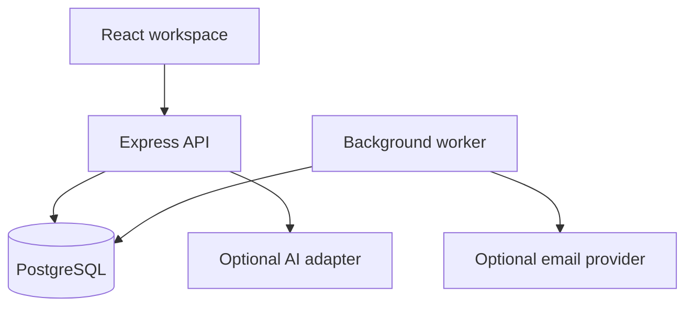

# TicketPilot AI

A customer-support workspace for businesses: persist tickets and conversations, collaborate across a team, inspect support analytics, and review optional evidence-backed response drafts.

This repository is a production-oriented starting point, not a production-readiness certification. See [release readiness](docs/release-readiness.md) for the exact implemented, verified, blocked, and remaining work. External model/email integration and a live deployment require separate validation.

## Product workflow

Register a workspace, create a ticket, assign it to a member, write a public reply or internal note, and resolve it. Knowledge documents support optional AI assistance. Separate organizations operate through membership-scoped APIs. The normal support workflow does not require an AI key.

The source includes authentication/session handling, workspace roles, ticket search/filter/pagination, versioned edits, conversation/activity history, text knowledge intake, AI adapter boundaries, and database-backed analytics. Consult the release report for feature-by-feature verification rather than treating this inventory as an acceptance-test result.

## Stack and architecture

TypeScript · Node.js 24 · Express · React · Vite · PostgreSQL 16 · SQL migrations · Node test runner · PGlite integration-test runtime.



The modular monolith keeps deployment small and transactions simple. [API contracts](docs/api.md) document requests and responses. [Architecture](docs/architecture.md) covers data relationships, authentication, ticket flow, AI retrieval, job boundaries, and failure handling. [ADR 0001](docs/adr/0001-modular-monolith.md) explains the trade-offs.

## Quick start — no Docker required

Install Node.js 24, then run:

```sh
npm ci
npm run build
AI_PROVIDER=local npm run dev
```

Open `http://localhost:3000` and register your own account and workspace. With no `DATABASE_URL`, development mode automatically migrates an embedded PostgreSQL database and persists records in `.local-data`. Keep that directory to preserve local tickets. This is a development convenience, not the production runtime. If you copied `.env.example`, leave `DATABASE_URL` empty to use it.

`npm run dev` serves the built React files, so rebuild after frontend edits. For live frontend editing, run `APP_ORIGIN=http://localhost:5173 npm run dev` and `npm run dev:web` in separate terminals, then open port 5173. The Vite proxy forwards API requests to port 3000.

The `local` AI provider is a deterministic extractive baseline, not an LLM. Set `AI_PROVIDER=disabled` to exercise manual support without assistance. Registering uses your own password; no shared credentials are published.

## PostgreSQL and Docker

For the production-style runtime, copy `.env.example` to `.env`, set `DATABASE_URL`, and run `npm run migrate`. Start with `npm run build` then `node --env-file=.env dist/server/index.js`. Run `npm run worker` in another process for scheduled jobs and configured delivery. PostgreSQL 16 with pgvector is provided in Compose; semantic embeddings remain optional.

To create development sample data against `DATABASE_URL`, set `DEMO_PASSWORD` (12–72 characters) and run `npm run seed`. The seed is disabled in production and does not overwrite existing account passwords. For embedded mode, create examples through the interface.

[Operations](docs/operations.md) gives Compose commands, HTTPS configuration, staging, backup/restore, and rollback. No infrastructure is purchased or deployed by these commands alone.

## Environment

| Variable | Purpose |
| --- | --- |
| `DATABASE_URL` | PostgreSQL connection string; leave empty for embedded development |
| `APP_ORIGIN` | Exact trusted browser origin |
| `PORT` | HTTP listen port, normally 3000 |
| `NODE_ENV` | Production enables production cookie/security behavior |
| `AI_PROVIDER` | `disabled`, `local`, or `openai` |
| `OPENAI_API_KEY`, `AI_MODEL` | Opt-in external model configuration |
| `EMBEDDING_PROVIDER` | `disabled` (full-text retrieval) or `openai` (pgvector embeddings) |
| `OPENAI_EMBEDDING_MODEL` | Optional embedding model; defaults to `text-embedding-3-small`, 1536 dimensions |
| `EMAIL_PROVIDER` | `disabled` or configured external adapter |
| `RESEND_API_KEY`, `EMAIL_FROM` | Configured outbound mail credentials and sender |
| `INBOUND_WEBHOOK_SECRET` | Signature verification for the custom inbound adapter |

External providers may receive customer content. Use approved test data in staging. See adapter source for exact contracts and configuration. Do not assume any arbitrary provider webhook is compatible with the custom inbound adapter.

## Verify changes

```sh
npm run lint
npm run check
npm test
npm run build
npm audit --omit=dev --audit-level=high
npm run evaluate
```

Browser acceptance tests use `npm run test:e2e` after installing Playwright Chromium and configuring a disposable PostgreSQL `DATABASE_URL`. CI provisions pgvector/PostgreSQL and installs Chromium. Never point acceptance tests at customer data. `TEST_DATABASE_URL` enables the real PostgreSQL contract test when present.

CI runs these checks. Tests using PGlite exercise embedded PostgreSQL, not a deployed PostgreSQL server. Deterministic provider tests are separate from live-provider verification. Browser, Docker, security-audit, load-test, and evaluation evidence should be recorded in the release report only after execution.

[Metrics](docs/metrics.md) defines the intended dashboard calculations and load-measurement requirements. Do not quote throughput or latency without recording the workload and environment.

## AI and knowledge

The API selects documents within the authorized workspace before calling the provider. The local baseline retrieves text evidence and can abstain; the optional external adapter uses validated structured output and bounded citations. A draft is not sent automatically. An authorized agent must inspect and edit or approve it.

The evaluation dataset and scripts under `evaluations/` are reproducible regression tools. Report their actual outputs and limitations; a small local dataset does not demonstrate production groundedness. Knowledge is chunked and persisted with document versions. The default path uses PostgreSQL full-text retrieval. Optional `EMBEDDING_PROVIDER=openai` uses a pgvector embedding table and the configured embedding model; it requires real provider credentials and a database with the vector extension. External embedding quality and availability require separate live verification. PDF/Office parsing and binary attachments are outside the supported text-document boundary.

## Security and limitations

Session cookies, password hashing, CSRF/origin validation, server-side roles, organization-scoped queries, bounded inputs, parameterized SQL, and optimistic version checks define the initial security design. [Security review](docs/security-review.md) lists the boundaries and work required before a customer pilot.

Known gaps must remain explicit: no claim of live external integration, real cloud deployment, comprehensive browser regression coverage, production performance, or completion of every requested feature. Billing is not enabled. See the release report for the final status of password reset, invitations, email threading, automation, deletion/retention, semantic retrieval, and provider reliability.

## Learn and maintain

Start with [project overview](docs/learning/01-project-overview.md), which follows one ticket from React to PostgreSQL. The [learning directory](docs/learning/) explains the frontend, APIs, schema, security, system design, AI, Docker, debugging, and interview answers with practical exercises.

Potential next steps should follow measured gaps: staging integration checks, browser acceptance tests, representative semantic-retrieval evaluations, richer attachment handling, and operational monitoring. Prefer small changes with tests over adding infrastructure for appearance.
