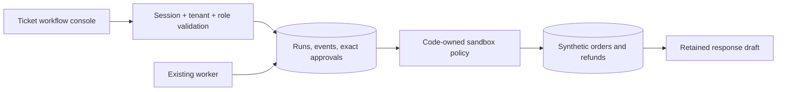

# Durable workflow foundation — 23 October 2026

## Implemented boundary

This milestone implements a **deterministic sandbox workflow**, not a model-driven multi-agent system. Capability names in the timeline describe ordinary backend functions. There is no LLM reasoning loop, live commerce adapter, autonomous refund authority, or model safety score. Existing optional AI drafting remains separate.

Migration `004_workflows.sql` adds tenant-scoped runs, events, approvals, synthetic orders and refunds. HTTP endpoints are in `server/routes/workflows.ts`; backend orchestration and the fixed proposal schema are in `server/workflows.ts`; `client/components/WorkflowConsole.tsx` displays the review workflow. No new runtime dependency is introduced.

## Data flow and state ownership

`CREATED → TRIAGED → GATHERING_CONTEXT → PLANNING → AWAITING_APPROVAL → EXECUTING → VERIFYING → COMPLETED`.

Each advance persists one transition and an event in one transaction. Rejection yields `CANCELLED`; stale resources, revoked authority, ineligible amounts or missing context yield `ESCALATED`; deadlines yield `TIMED_OUT`; exhausted step budgets or missing action results yield `FAILED`. `RETRY_PENDING` is reserved in the database vocabulary but has no separate retry scheduler yet. Unexpected database errors roll back the step; the existing worker's next poll retries unchanged durable state. This is not a complete bounded poison-job retry implementation.

A staff user explicitly selects an order; the server matches its tenant and customer email with the ticket. It never extracts a privileged identifier from customer prose. The administrator's demo control creates an INR 49.99 synthetic delayed order. The fixed policy permits a full refund only for an unrefunded delayed order up to INR 100.00. Documents and ticket text cannot grant eligibility. This is a demo rule, not a merchant's real refund policy, and no policy retrieval is claimed for this workflow.

The proposal contains order ID, amount in integer minor units, INR currency, ticket/order versions and policy version. Zod rejects unknown fields and invalid values. SHA-256 over a fixed field order binds the exact validated arguments; the approval row binds that digest to a specific tenant and run. Digests are integrity bindings, not cryptographic signatures or tamper-proof storage against a database administrator.

Owner/admin approval stores actor, reason, digest, decision and a one-hour expiry. Execution locks and rechecks current initiator and approver membership, approval validity, action digest, current resource versions, customer binding, shipment status and refund status. Unique constraints enforce at most one synthetic refund per order and per run. Refund insert, order update, audit event and transition to `VERIFYING` commit atomically. A rollback test injects failure after the insert and proves safe retry. Verification reconciles an already committed action even when its original deadline passes or the ticket closes.

The composed response cites the stored synthetic refund result in plain language and stays on the workflow record. No message or outbox row is created. Existing normal reply controls continue to require a human action. Any future provider adapter needs its own explicit authorization, scoped credentials, external idempotency, reconciliation and failure handling.

## Durable execution and limits

- Worker `processWorkflowJobs` selects at most 20 active runs with `FOR UPDATE SKIP LOCKED`. Native PostgreSQL can coordinate independent workers; local PGlite tests only demonstrate serialized embedded behavior.
- One batch transaction covers the selected deterministic database-only steps. Do not put network calls inside these transactions. A failing run currently rolls back its batch; isolate poison jobs and add bounded retry/backoff before provider execution.
- Tenant row locking serializes start-time quota and idempotency checks. There may be at most five active runs per workspace; terminal runs release capacity.
- A tenant-scoped UUID idempotency key returns its original run; reusing it with different ticket/order arguments returns 409.
- Maximum 12 state-step tool calls and 24-hour workflow deadline. Waiting approvals expire with the workflow deadline; accepted approvals expire one hour after the decision. Counts describe deterministic steps, not provider SDK tool calls.
- Usage explicitly records deterministic provider, null model, zero tokens and zero cost. No inferred provider usage or guessed price is reported.
- Runtime roles are revalidated under locks inside writes; UI controls are convenience, not authorization.

## Memory, access and deletion

There is no global agent memory. Runs belong to a tenant and ticket. Staff can inspect their tenant's runs; customer-role accounts cannot inspect internal workflow evidence. Ticket deletion cascades runs/events/approvals/synthetic refund rows. Synthetic orders and organization-level audit records remain until organization deletion or a future retention job. No complete account/organization erasure API or backup/provider erasure process exists; do not present ticket deletion as complete erasure. Evidence summaries omit raw customer message content, credentials, hidden reasoning and model traces.

## Technology decision

See [ADR 0002](adr/0002-durable-workflow-foundation.md). Keep PostgreSQL as the source of authorization and business state. Evaluate model-generated plans behind this boundary in a subsequent milestone. Tests now exercise the workflow without requiring a model, reducing the chance that model variability obscures an authorization failure.

## Remaining gate work

This is a Phase 2 foundation and a partial Phase 3 sandbox slice. Before calling Phase 3 complete, add organization policy retrieval with source/version snapshots, missing/ambiguous order selection, configurable monetary policy, revision UI, approved reply handoff, and a provider adapter contract. Before Phase 4, add the selected model adapter behind an explicit test budget, representative reviewed evals, and measured groundedness. Native contention, Docker, restore drills and deployment remain separate operational gates.
