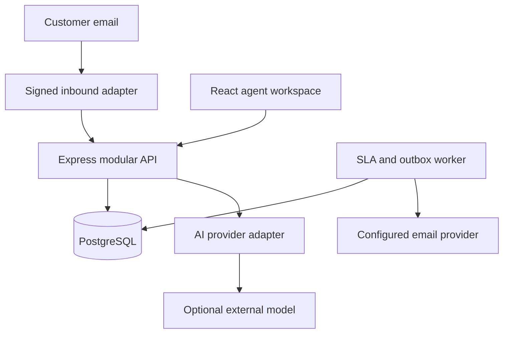
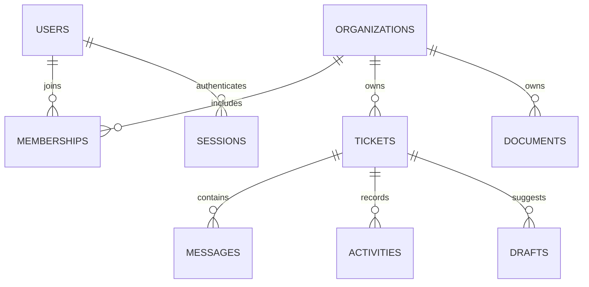
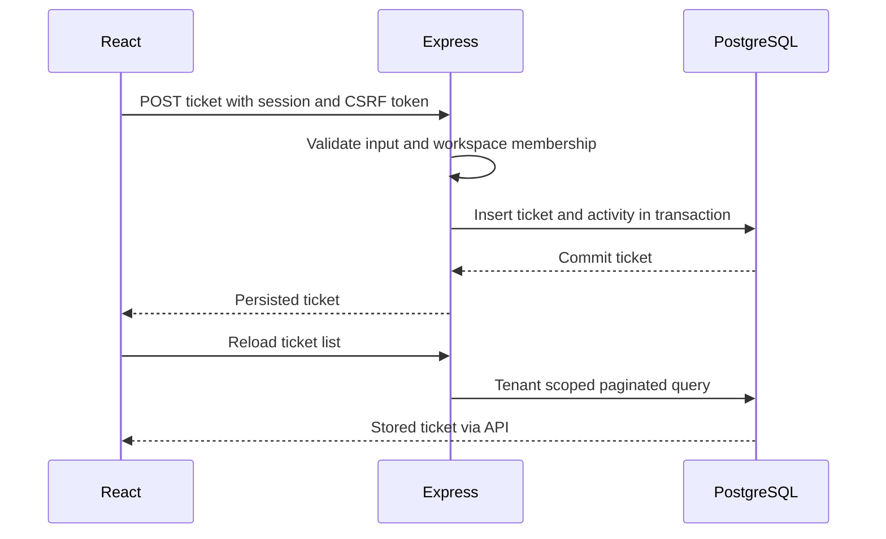

# Architecture and security boundaries

Only the API can authorize browser requests. Selecting a workspace in React is a UI preference; every protected server operation must validate membership and scope queries using the selected organization. The worker reads organization IDs from persisted jobs rather than accepting a browser's tenant claims.

This diagram describes relationships; migrations are authoritative for exact table/column names and constraints.

## Ticket creation

## Authentication

Registration hashes the password and creates a user, workspace, and owner membership. Login verifies a password and creates an opaque browser session. The server stores a hash of the session secret; the raw secret travels only in an HttpOnly cookie. An authenticated response supplies a CSRF token for modifying requests. Logout revokes the session. Origin checking complements CSRF checking. Production cookies require HTTPS.

## Retrieval and drafting

The API authorizes a ticket, retrieves only that workspace's current document passages, and passes bounded ticket/history/evidence context to the AI module. Knowledge indexing persists overlapping chunks with their document version. Retrieval uses PostgreSQL full-text search by default; an optional OpenAI embedding adapter stores vectors in pgvector. Tenant predicates and current document-version joins apply to both. The local draft provider quotes retrieved evidence; it is not an LLM. External model output must satisfy a schema and refer only to supplied citation IDs. Uploaded text is untrusted evidence, never an instruction source. A draft is stored separately from a sent message. An agent can reject, edit, or send it.

Prompt-injection filters and structured outputs reduce risk but cannot prove semantic grounding. No AI provider can modify tickets or send email directly. The external provider may process customer information: enable it only after deciding what data is permitted to leave your deployment.

## Background work and failures

The worker periodically checks response/resolution deadlines and processes an outbox. Jobs must remain retryable and bounded. Email delivery failures must not roll back an already persisted human reply. Provider idempotency support reduces duplicate delivery; exactly-once email is not guaranteed. Check worker logs and persisted failed jobs before manually retrying.

Optimistic ticket versions reject stale edits with HTTP 409. The UI reloads the latest version before retrying. Database constraints protect relationships; tenant scoping and assignment membership validation protect ownership. Transactions keep multi-step writes atomic.

Database outages make readiness fail. AI outages return a recoverable error while manual conversation operations remain available. HTTP errors must not include stack traces or credentials. Request IDs connect API responses with structured server logs; avoid logging message bodies, passwords, tokens, or document contents.
