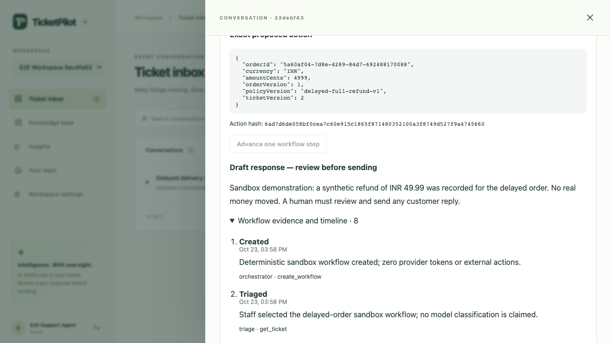

# Sandbox workflow milestone verification — 2026-10-23

Final local acceptance was rerun after the workflow authorization, proposal integrity, concurrent execution, and post-execution reconciliation changes. Environment and initial baseline are recorded in [baseline-audit.md](baseline-audit.md).

## Executed checks

| Command | Final observed result |
| --- | --- |
| `npm test` | **38 passed, zero failures or skips**, 7.3 seconds. Uses embedded PostgreSQL/PGlite locally. |
| `npm run check` | TypeScript checks passed. |
| `npm run lint` | Prettier checks passed. |
| `npm run build` | Server compilation and production client build passed; 25 frontend modules. |
| `npm run evaluate` | 18 handcrafted classification examples; accuracy 0.7222, macro F1 0.7576; all five retrieval/extraction/abstention smoke checks passed. No larger dataset or live model claim. |
| `E2E_CHROMIUM_EXECUTABLE='/Applications/Google Chrome.app/Contents/MacOS/Google Chrome' npm run test:e2e` | Full authenticated browser acceptance passed, 11.6 seconds including build/start. Google Chrome with isolated temporary PGlite data. |

The production npm advisory check also passed earlier in this session with zero reported vulnerabilities. No dependency changes were made after that check. The baseline HTTP smoke load and its limitations are recorded separately; it was not used as a workflow concurrency benchmark.

## Browser acceptance

The test registers a real synthetic workspace through the UI, imports a Markdown policy, creates and assigns a ticket, and exercises both human decision paths:

1. Create a synthetic order and start a persisted workflow.
2. Advance through triage, context gathering and planning to `AWAITING_APPROVAL`.
3. Reject the first exact proposal, verify persisted `CANCELLED` state and recorded rejection.
4. Create a second synthetic order/run, review its proposal and approve the exact action hash with a reason.
5. Advance to `VERIFYING` and then `COMPLETED`, verify the recorded approval matches the action hash and the execution tool appears in the event trail.
6. Verify the response remains a draft, no message POST occurs, and the ticket's stored messages remain unchanged.
7. Continue the ordinary cited local AI reply, human send, resolution, reload persistence, logout and login workflow.
8. Confirm another tenant receives 404 when reading the workflow and ticket, and 403 when impersonating the owning workspace.

The screenshot below is captured directly by Playwright from the tested application with synthetic data. It shows the drawer scrolled to the retained draft; upper workflow controls and the longer timeline require normal drawer scrolling. The draft and action hash are readable with no horizontal clipping at the 1280×720 test viewport. This is desktop evidence, not a complete accessibility or mobile audit.

## Database and reliability assertions

The workflow integration suite verifies tenant-scoped lookup, start idempotency, role boundaries, exact approval hashes, persisted worker progression, a single synthetic refund, zero queued customer email, changed ticket/order context, proposal tampering, approval expiry, approver removal, monetary/tool budgets, workflow deadlines, ambiguous customer context, concurrent approvals/resumes, and rollback of refund/state on simulated failure. Post-execution verification still reconciles a committed synthetic refund when the deadline passes or the ticket closes.

The email regression verifies that a crash during the final delivery attempt becomes a terminal failure after its lease expires rather than remaining stranded indefinitely.

## Verification boundary

- All actions and refunds are synthetic database operations. No real payment, customer email, external AI request, embedding request or paid provider was triggered.
- Locally observed concurrency uses PGlite, which serializes database transactions. It verifies application idempotency and invariants under concurrent requests, not native PostgreSQL connection-pool contention or multi-process row locks.
- Native PostgreSQL, pgvector behavior, Docker and a new CI execution were not available to this local verification task. CI is configured to run tests against PostgreSQL/pgvector and now also runs the existing evaluation command; its actual result must be checked independently.
- No live/staging deployment, restore drill, representative model evaluation, multilingual assessment or production capacity claim follows from these checks.
